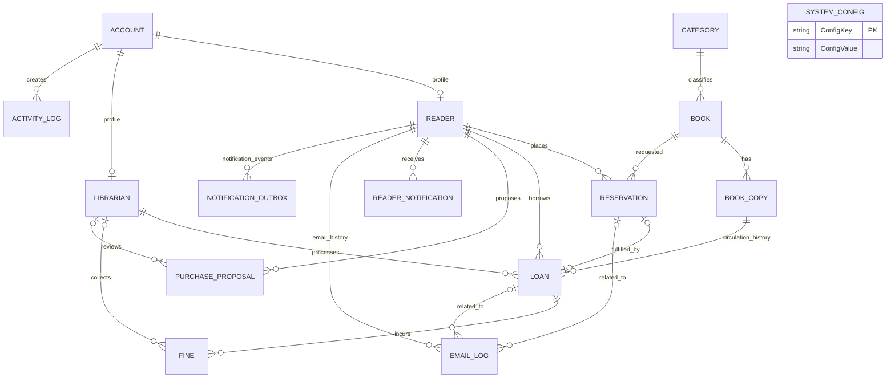

# Báo cáo phân tích và truy vết yêu cầu LiMS

Ngày cập nhật: 24/11/2026. Báo cáo này bổ sung cho `docs/requirements/Library-Management-PRD.docx`; các trạng thái bên dưới căn cứ vào source code hiện tại.

## 1. Mục tiêu và phạm vi bàn giao

LiMS cung cấp Web cho độc giả và Desktop Windows Forms cho thủ thư/Admin. Hai client gọi chung `LiMS.Api`; API xác thực, xử lý nghiệp vụ và truy cập Microsoft SQL Server qua EF Core. Mục tiêu nghiệp vụ của bản hiện tại là tra cứu, đặt giữ, theo dõi/gia hạn phiếu mượn, quản lý danh mục/sách/độc giả, mượn trả tại quầy, thu phạt, duyệt đề xuất và báo cáo.

Stack triển khai là **Windows Forms + ASP.NET Core Razor Pages + ASP.NET Core Web API + EF Core + SQL Server**. Nội dung khảo sát React/TypeScript/SPA trong PRD là khảo sát phương án ban đầu, không phải mô tả frontend đang triển khai.

### Ngoài phạm vi của bản bàn giao hiện tại

- Gợi ý sách bằng AI: chưa triển khai; chuyển sang backlog tương lai.
- Gửi email tự động và khôi phục mật khẩu qua email: chưa triển khai; trang quên mật khẩu hướng dẫn liên hệ thủ thư. Notification trong ứng dụng và outbox không phải email delivery.
- Tích hợp SDK/driver máy quét hoặc quét QR bằng camera: chưa triển khai. Form mượn/trả nhận barcode qua ô nhập và có thể dùng scanner hoạt động như bàn phím.
- Thanh toán trực tuyến: không nằm trong phạm vi nghiệp vụ hiện tại.

## 2. Khảo sát giải pháp

| Nhóm tham khảo | Quan sát | Liên hệ với LiMS |
|---|---|---|
| Desktop thư viện độc lập | Dễ thao tác tại quầy nhưng không tự cung cấp trải nghiệm tra cứu từ xa nếu không có phân hệ Web/dịch vụ đồng bộ. Đây là nhận định định tính trong PRD, chưa phải khảo sát đo lường tại một cơ sở cụ thể. | LiMS giữ WinForms cho thủ thư và tách API/Web để độc giả truy cập riêng. |
| Koha | Hệ thống ILS mã nguồn mở, giao diện nghiệp vụ dựa trên Web và có OPAC/catalogue cho độc giả. Xem [trang giới thiệu Koha](https://koha-community.org/about/) và [tài liệu Koha](https://koha-community.org/manual/). | Koha là mốc tham khảo về phân hệ thư viện tích hợp; LiMS có phạm vi nhỏ hơn, tùy chỉnh cho quy trình đồ án và dùng stack .NET/SQL Server. |
| Stack .NET | Razor Pages, EF Core và SQL Server là stack thực tế trong solution. Xem [Microsoft Learn: Razor Pages và EF Core](https://learn.microsoft.com/en-us/aspnet/core/data/ef-rp/intro?view=aspnetcore-10.0). | Thay thế mô tả React/SPA ở phần giải pháp cuối; không dùng Node event loop làm mô tả kiến trúc LiMS. |

Đây là khảo sát định hướng, không phải đánh giá benchmark. Muốn kết luận ưu/nhược điểm hiệu năng hoặc usability cần tiêu chí, nguồn, phiên bản phần mềm và số liệu kiểm tra cụ thể.

## 3. Phân tích chức năng và giao diện

| Tác nhân | Chức năng chính | Giao diện / mã nguồn |
|---|---|---|
| Độc giả | Đăng nhập, tra cứu/lọc/sắp xếp sách, xem chi tiết, đặt/hủy giữ, xem phiếu mượn, gia hạn, thông báo, cập nhật hồ sơ, gửi đề xuất mua sách. | `LiMS.Web/Pages/`; `LiMS.Web/Services/LibraryApiClient.cs`; `LiMS.Api/Controllers/LibraryController.cs`, `ReaderController.cs`, `AuthController.cs`. |
| Thủ thư | Tìm và quản lý đầu sách, thể loại, bản sao; quản lý hồ sơ/thẻ; lập mượn, nhận trả, gia hạn; ghi nhận phạt; xét đề xuất. | `LiMS.Admin/Forms/AdminMainForm.cs`; `LiMS.Admin/Services/AdminApiClient.cs`; `LiMS.Api/Controllers/AdminController.cs`. |
| Admin | Các quyền thủ thư, thêm quản trị cấu hình, nhật ký thao tác và backup/restore. | Các nhánh role trong `AdminMainForm.cs` và `[Authorize]` trên endpoint `AdminController.cs`. |
| Hệ thống | Hết hạn đặt giữ, xử lý notification outbox và lập lịch nhắc hạn nội bộ. | `LiMS.Api/Services/XuLyHetHanDatGiuSachBackgroundService.cs`, `NotificationOutboxProcessorService.cs`, `LoanNotificationSchedulerService.cs`. |

Website dùng viewport meta, thanh điều hướng mobile và breakpoint trong `LiMS.Web/Pages/Shared/_Layout.cshtml`, `LiMS.Web/wwwroot/css/lims.css`, `lims-overrides.css`, `design-system.css`. Cần nghiệm thu bằng trình duyệt ở 360, 390, 768, 1024 px và desktop; source CSS không thay thế kiểm tra hiển thị thực.

## 4. ERD vật lý hiện hành

`SYSTEM_CONFIG` là bảng key/value độc lập. Sơ đồ này được dựng từ `LiMS.Api/Models/LibraryEntities.cs` và `LiMS.Api/Data/LiMSDbContext.cs`; migration mới hơn là nguồn triển khai. Quan hệ `RESERVATION`–`LOAN` được giới hạn duy nhất ở phía Loan khi có `ReservationId`.

### Lược đồ quan hệ và khóa chính/duy nhất

| Bảng | Khóa chính | Khóa ngoại/chỉ mục duy nhất đáng chú ý |
|---|---|---|
| ACCOUNT | AccountId | Username, Email unique |
| READER | ReaderId | AccountId, CardNo unique; FK ACCOUNT |
| LIBRARIAN | LibrarianId | AccountId, StaffCode unique; FK ACCOUNT |
| CATEGORY | CategoryId | Name unique |
| BOOK | BookId | FK CATEGORY; ISBN unique khi khác null |
| BOOK_COPY | CopyId | Barcode unique; FK BOOK |
| RESERVATION | ReservationId | FK READER, BOOK; index theo hàng đợi |
| LOAN | LoanId | FK READER, BOOK_COPY, LIBRARIAN; tối đa một loan đang mở trên mỗi bản sao; ReservationId unique khi khác null |
| FINE | FineId | FK LOAN và LIBRARIAN thu phạt |
| PURCHASE_PROPOSAL | ProposalId | FK READER và LIBRARIAN xét duyệt |
| ACTIVITY_LOG | LogId | FK ACCOUNT |
| READER_NOTIFICATION | NotificationId | FK READER; deduplication key unique |
| NOTIFICATION_OUTBOX | OutboxId | FK READER; deduplication key unique |
| EMAIL_LOG | EmailId | FK READER; FK tùy chọn LOAN/RESERVATION |
| SYSTEM_CONFIG | ConfigKey | Không có FK |

Các entity không gán nhiều giá trị lặp trong cùng cột; dữ liệu thể loại, đầu sách, bản sao, độc giả và giao dịch được tách theo thực thể. Đây là mô tả chuẩn hóa ở mức quan hệ phục vụ đồ án, không thay thế kiểm định 3NF độc lập trên mọi thuộc tính nghiệp vụ.

## 5. Ma trận truy vết yêu cầu–màn hình–API–dữ liệu

| Yêu cầu | Màn hình | API/nghiệp vụ | Bảng chính | Trạng thái |
|---|---|---|---|---|
| Tra cứu, lọc và xem chi tiết sách | Web Catalog, Book | `LibraryController` + `LibraryQueryService` | BOOK, CATEGORY, BOOK_COPY | Có |
| Đặt giữ/hủy và xem trạng thái | Web Book, Reservations | `ReaderController` + `ReaderService`/queue | RESERVATION, BOOK, READER | Có |
| Theo dõi và gia hạn phiếu mượn | Web Loans/Renewal | `ReaderController` | LOAN, BOOK_COPY | Có |
| Cập nhật hồ sơ và thông báo | Web Profile/Notifications | `ReaderController`, `NotificationService` | ACCOUNT, READER, READER_NOTIFICATION | Có |
| Thêm/sửa/ngừng đầu sách và quản lý bản sao | Desktop Kho sách | `AdminController`, `AdminService` | BOOK, BOOK_COPY, CATEGORY | Có |
| Quản lý thể loại | Desktop Thể loại sách | `AdminController` category CRUD | CATEGORY, BOOK | Có sau bổ sung |
| Độc giả, mượn/trả, tiền phạt, đề xuất | Desktop các tab tương ứng | `AdminController`/`AdminService` | READER, LOAN, FINE, PURCHASE_PROPOSAL | Có |
| Gợi ý sách AI, email tự động | Không có màn hình/luồng backend hiện hành | Chưa triển khai | — | Ngoài phạm vi bản bàn giao |
| Khôi phục mật khẩu email | Trang ForgotPassword chỉ hướng dẫn liên hệ thủ thư | Không có endpoint gửi email | — | Chưa triển khai |

## 6. Triển khai và kiểm chứng SQL Server

`LiMS.Api/Data/Migrations` và `LiMS.Api/Data/DatabaseInitializer.cs` là cơ chế schema hiện hành. `database/LiMSDB-schema-snapshot-20261115.sql` được giữ lại để tham khảo lịch sử, không chạy để tạo schema mới. API có endpoint `GET /api/library/health`; chỉ khi endpoint trả `database: true`, migration history/schema được kiểm tra trên instance mục tiêu, và Web/Desktop đọc-ghi chéo được thử thành công mới kết luận dữ liệu đã triển khai đúng trên MSSQL.

Hiện chưa có kết quả xác minh instance SQL Server của môi trường chấm bài trong repo. Test dùng EF Core InMemory không chứng minh migration, khóa, isolation hay concurrency thực tế trên SQL Server.
